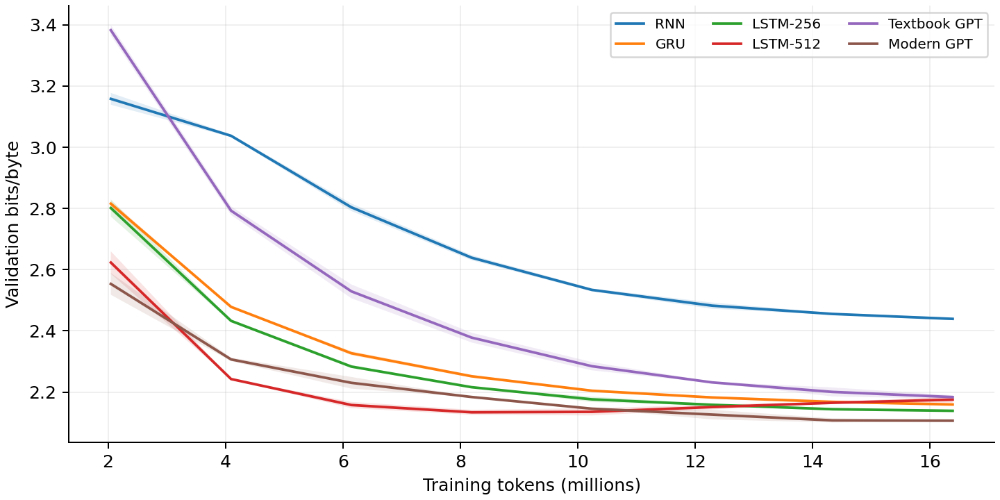
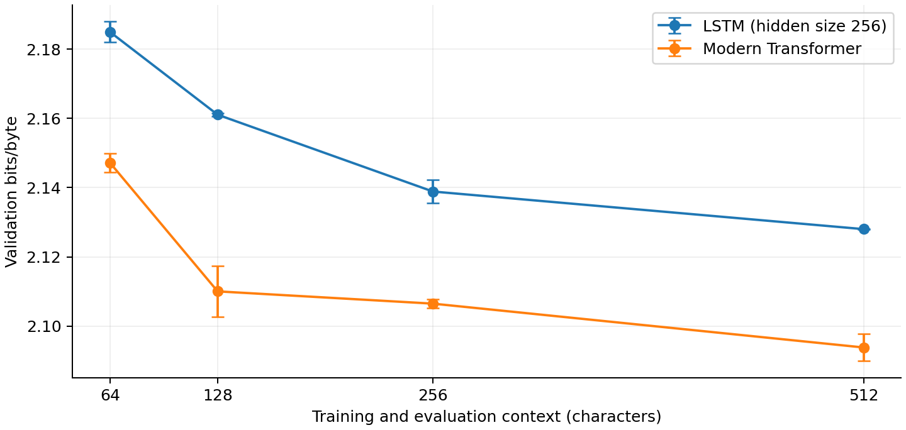

# Language Models from Scratch: RNNs vs. Transformers

How much do architecture, model size, and context length affect next-character prediction?

This project compares six language-model configurations on Tiny Shakespeare using the same training-token budget and two random seeds. It also checks language-model metrics by hand and examines attention patterns in a trained Transformer.

Completed for CMPE 258 - Deep Learning at San José State University.

**Author:** Smitha Soman  
**Environment:** Google Colab, NVIDIA Tesla T4, PyTorch  
**Training budget:** 16,384,000 tokens per run  
**Seeds:** 42 and 1337

[Read the full report](HW1_Report.pdf)

## Results

Lower validation bits per byte (bpb) means better prediction. Values below are the mean and sample standard deviation across two seeds.

| Model | Parameters | Validation bpb | Mean training time |
|---|---:|---:|---:|
| Modern Transformer | 3.163M | 2.1065 ± 0.0013 | 3.02 min |
| LSTM-256 | 1.070M | 2.1389 ± 0.0034 | 1.02 min |
| GRU | 0.807M | 2.1595 ± 0.0009 | 0.78 min |
| LSTM-512 | 4.237M | 2.1754 ± 0.0100 | 3.48 min |
| Textbook Transformer | 3.438M | 2.1837 ± 0.0059 | 2.62 min |
| Vanilla RNN | 0.280M | 2.4392 ± 0.0041 | 0.26 min |



## What I found

- The modern Transformer achieved the lowest validation bpb. The smaller LSTM was the strongest recurrent model and trained about three times faster.
- The larger LSTM fit the training data better but finished with worse validation performance. Its validation loss rose after reaching its best score midway through training, showing overfitting.
- Both the LSTM and modern Transformer had their best mean scores at a context length of 512. Neither showed a clear stopping point within the tested range.
- The Transformer performed better at every context length, but both models gained a similar amount from extending context from 64 to 512 characters.
- Attention measurements identified a head that favored the previous character and another that favored the current word's first character.



## Experiments

1. **Metric checks:** Recomputed perplexity, bits/token, and bits/byte from saved validation metrics; compared untrained character and byte models against uniform predictions.
2. **Architecture comparison:** Trained RNN, GRU, two LSTM sizes, and textbook and modern Transformers with equal token budgets.
3. **Context length:** Compared LSTM and modern Transformer at 64, 128, 256, and 512 characters.
4. **Attention analysis:** Measured attention patterns on dialogue, prose, and repetitive text. Word-start measurements excluded positions where word start was also the previous character.

## Scope and limitations

These results use one small dataset and two seeds. Learning rates and weight decay differ between recurrent and Transformer configurations, so the comparison evaluates those training recipes as well as architecture. The context study changes training and evaluation context together. Attention patterns describe observed preferences, not proof of a head's causal role.

## Code attribution

Training and model implementations come from the course's
[nanolm tutorial and code](https://github.com/lkk688/DeepDataMiningLearning/tree/main/DeepDataMiningLearning/llm).

This repository documents my experiment runs, configurations, results, and report, alongside scripts used to analyze the saved outputs. The underlying model implementations are credited to the upstream project.

## Files and reproduction

This package contains the experimental evidence for the accompanying report. It uses the nanolm implementation in [DeepDataMiningLearning](https://github.com/lkk688/DeepDataMiningLearning). Credit for the training implementation and tutorial belongs to that project; the analysis here summarizes the saved homework runs.

## Contents

- `runs/`: metrics, training/evaluation logs and original per-run metadata.
- `configs/`: portable resolved configurations for 26 unique runs.
- `original_colab_configs/`: original supplied configurations.
- `analysis/architecture_vs_lstm/`: original analyzer output, including summary.csv and summary.md.
- `attention/`: three input texts, raw attention arrays, original plots and measurements.
- `report_analysis/`: regenerated figures, statistical tables and metric checks.
- `scripts/`: plotting and measurement scripts.
- `run_manifest.json`, `version_check.txt`: provenance and compute accounting.
- `Report_editable.md`: editable report text (HTML formatting within paragraphs).

There are no model checkpoints or training datasets in this ZIP. Keep the existing Colab/Drive checkpoint if generating new samples or attention maps. 

> Extra credit: implemented a GRU cell gate by gate and verified its sequence outputs and final hidden states against PyTorch nn.GRU in 18 CPU float64 tests. All passed; the largest output difference was 3.331e-16. See [implementation and verification](extra_credit/README.md).

## Reproduce analysis without retraining

Install numpy, pandas, scipy and matplotlib in a Python environment. From this directory:

```bash
python scripts/analyze_results.py
python scripts/measure_attention.py
```

The scripts use paths relative to their own location and regenerate the report_analysis outputs. The attention script restricts word-start measurements to third and later letters to distinguish word start from the immediately previous character. Three-text summary means weight texts equally.

## Reproduce training

Clone the upstream repository and check out commit `8418fc1bae85657190f11749483bf2e729b9702c`. Follow its dependency installation instructions, then work from `DeepDataMiningLearning/llm`. The original architecture runs used `cc64ca3ed3aa1ce7df3cf381c492bc7a9826b749`; the user verified no changes in the nanolm directory between these versions. Numerical results can vary with hardware and dependency versions.

Run a portable configuration using its absolute path, for example:

```bash
python -m nanolm.train --config /absolute/path/HW1_Supporting_Files/configs/architecture/gpt_modern_seed1337.yaml
```

All 26 configuration files are independent. Do not rerun 256-context experiments: use the matching architecture runs. Other contexts use batch size 8192 / context length and 2000 steps. The two untrained runs use one step with zero learning rates and weight decay, preserving initialized weights. Configurations redirect output paths but preserve numerical settings; inspect them before launching a long job.

To reproduce a visualization with an available checkpoint:

```bash
python -m nanolm.viz attention --run /absolute/path/to/run --text "The little bird flew over the garden and into the trees."
```

Repeat for the texts in attention/texts.json. Copy each generated image before the next command because the visualization command can overwrite its default output filename.

## Interpretation and submission

Lower bpb is better. Reported SD uses two seeds, not a confidence interval. Saved paired p-values are unadjusted and exploratory. Training recipes differ in learning rate and weight decay. Context experiments change both training and evaluation length, and validation token coverage varies slightly.
