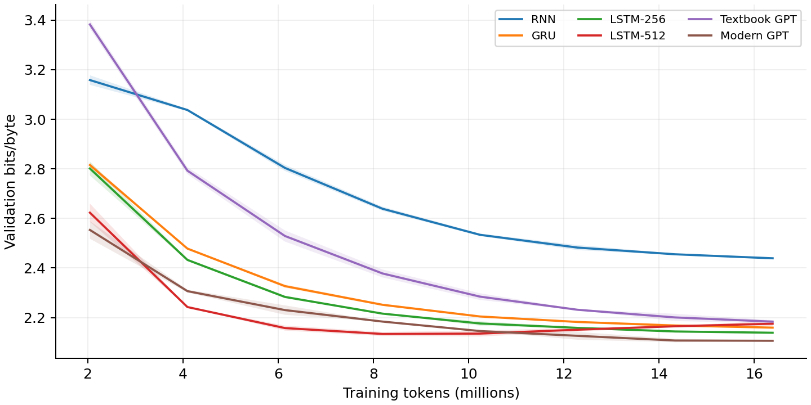
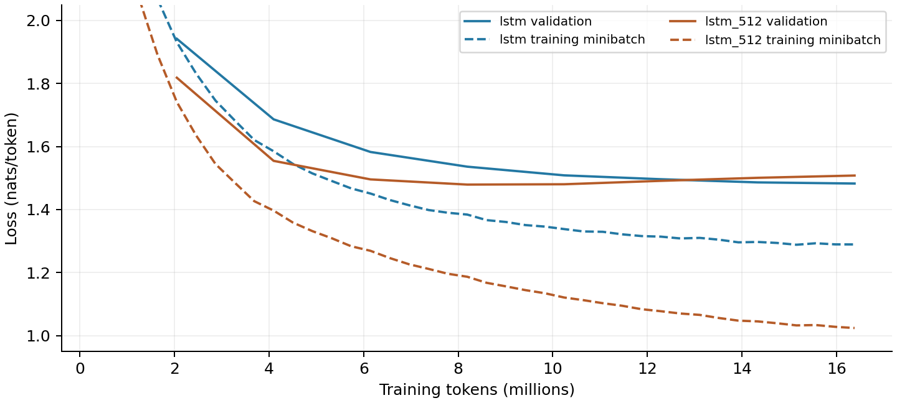
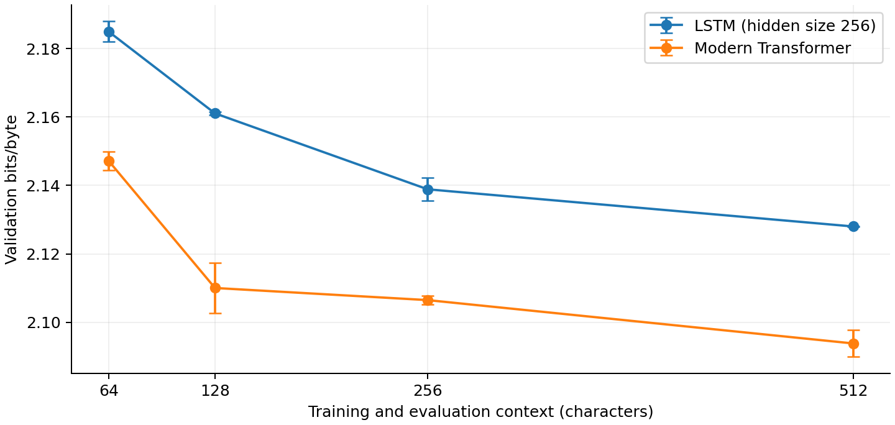
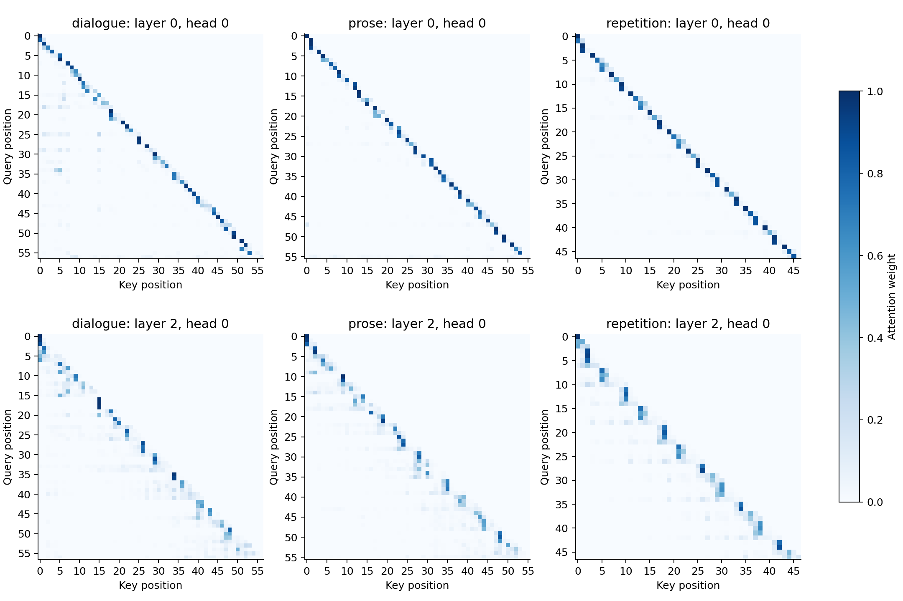

# Language models from scratch

<b>HW 1 - Part 1</b> Tiny Shakespeare: metrics, recurrent models, context length and attention

This experiment asks how well different models predict the next character under the same training-token budget. The main expectations are that gated recurrent models will outperform a vanilla RNN, and that more context may help prediction. A larger model may fit the training text better without improving validation performance.

<b>Setup.</b> The character tokenizer has 65 symbols. The dataset contains 1,003,854 training tokens and 111,540 validation tokens. Each architecture receives 16,384,000 training tokens (2,000 steps of 8,192 tokens), with seeds 42 and 1337. Runs use an NVIDIA Tesla T4, CUDA and FP32. Validation bits per byte (bpb) is the main metric; lower is better. Full settings and provenance appear in the appendix.

<b>Metrics by hand.</b> Let L be mean negative log-likelihood in natural-log units, N the validation-token count and B the byte count. Then total NLL = L x N; perplexity = exp(L); bits/token = L / ln(2); bpb = L x N / (B x ln(2)).

For the trained modern Transformer, seed 1337, metrics.json records L = 1.4607713136221696 and N = B = 111,360. The reconstructed total NLL is 162,671.493485. Dividing by N recovers L. This checks the aggregation convention; it is not an independent evaluation of token probabilities.

Quantity | Recomputed | Logged

Perplexity | 4.309282055 | 4.309282055

Bits/token | 2.107447530 | -

Bits/byte | 2.107447530 | 2.107447530

<b>Untrained baseline.</b> One step with learning rates and weight decay set to zero leaves the initialized weights unchanged. Both checks use 111,488 tokens and bytes. A uniform predictor has loss ln(V) and perplexity V.

Tokenizer | V | ln(V) | Measured loss | Perplexity | bpb

Character | 65 | 4.174387 | 4.162828 | 64.2530 | 6.0057

Byte | 256 | 5.545177 | 5.559498 | 259.6926 | 8.0207

The measured losses are close to ln(V), differing by -0.011559 and +0.014321. Random initialization is not exactly uniform. Uniform loss is not a lower bound: random predictions can slightly favor common characters, and perplexity can also exceed vocabulary size.

# Architecture comparison

The modern Transformer has the lowest mean validation bpb. The smaller LSTM is the best recurrent model and trains about three times faster in these runs. All reported standard deviations are sample standard deviations across only two seeds.

Model | Parameters | bpb mean +/- SD | Mean minutes

RNN | 280,320 | 2.4392 +/- 0.0041 | 0.264

GRU | 806,656 | 2.1595 +/- 0.0009 | 0.779

LSTM-256 | 1,069,824 | 2.1389 +/- 0.0034 | 1.020

LSTM-512 | 4,236,800 | 2.1754 +/- 0.0100 | 3.475

Textbook GPT | 3,438,336 | 2.1837 +/- 0.0059 | 2.617

Modern GPT | 3,162,624 | 2.1065 +/- 0.0013 | 3.023

<b>Figure 1.</b> Validation learning curves versus training tokens. Lines are seed means and shaded bands are +/- one seed standard deviation. Every run ends at the same token budget. The RNN remains substantially worse throughout the later part of training.

<b>Why does the vanilla RNN fall behind?</b> It repeatedly compresses past information into a hidden state without gates. Learning long dependencies is difficult because gradients can shrink or grow across many recurrent steps. LSTM and GRU gates help control what information is retained. This is a plausible explanation, not a measured gradient diagnosis. The RNN also has fewer parameters, so these results do not isolate gating from capacity.

Equal token budgets do not mean equal compute. The rough 6ND estimate ranges from 0.028 PFLOPs for the RNN to 0.416 PFLOPs for LSTM-512 per run. This approximation uses total parameter count and omits architecture-specific attention and execution costs; measured times are more directly useful here.

# Why the larger LSTM loses

LSTM-512 finishes worse than LSTM-256: 2.1754 versus 2.1389 mean bpb, despite having almost four times as many parameters. Its curves show overfitting under this training recipe.

<b>Figure 2.</b> Mean training-minibatch loss and validation loss for the two LSTMs. Training values are noisy minibatch measurements with dropout active; validation uses evaluation mode. Their absolute gap is not a perfectly matched dataset comparison, but the opposing trajectories are informative.

Large LSTM seed | Best evaluated step | Best bpb | Final bpb

42 | 1,250 | 2.1272 | 2.1683

1337 | 1,000 | 2.1398 | 2.1825

The large LSTM reaches its best recorded validation score around the middle of training, then gets worse while training loss continues downward. Final training losses are about 1.02-1.03 nats for the large model, compared with 1.28-1.30 for the smaller model. More capacity helps fit the training text but does not improve final generalization. Early stopping or stronger regularization could help, but neither was tested.

<b>How strong are the comparisons?</b> The modern Transformer improves mean bpb over the smaller LSTM by 0.0324; the RNN is worse by 0.3003. Paired, two-sided t-tests across the two seeds give unadjusted p-values of 0.0280 and 0.0011, respectively. The large-LSTM difference gives p = 0.0815. With only two pairs, these are exploratory results, not strong evidence about a broad distribution of runs. Five comparisons were made against the LSTM, without multiplicity correction in the saved analysis.

The median within-model standard deviation is 0.0037 bpb. Twice that value is a useful descriptive scale, not a formal significance threshold. The recurrent and Transformer recipes also use different learning rates and weight decay. The comparison therefore evaluates these practical configurations rather than architecture alone.

# How much context helps?

LSTM-256 and the modern Transformer were trained with context lengths 64, 128, 256 and 512. Batch sizes were 128, 64, 32 and 16, respectively, keeping 8,192 tokens per step and 16,384,000 tokens per run. Both seeds were used at every length. Four existing 256-context runs were reused.

Context | Modern GPT bpb +/- SD | LSTM bpb +/- SD

64 | 2.14719 +/- 0.00276 | 2.18496 +/- 0.00297

128 | 2.11004 +/- 0.00738 | 2.16106 +/- 0.00040

256 | 2.10650 +/- 0.00134 | 2.13887 +/- 0.00336

512 | 2.09384 +/- 0.00387 | 2.12802 +/- 0.00008

<b>Figure 3.</b> Validation bpb against context length; error bars show +/- one seed standard deviation. Training and evaluation context change together, so this is not an isolated test of inference-time context.

<b>Where do they stop benefiting?</b> Neither has a clear stopping point within the tested range. Both have their best mean at 512. The LSTM gains become smaller: improvements are 0.02390, 0.02219 and 0.01086 bpb between successive lengths. The Transformer improves by 0.03714, 0.00354 and 0.01266. Its near-flat 128-to-256 result is followed by another improvement, so it does not establish a plateau.

<b>Which uses longer context more effectively?</b> The Transformer predicts better at every tested length, but the total 64-to-512 improvement is similar: 0.05335 bpb for the Transformer and 0.05694 for the LSTM. These data do not establish a larger context benefit for the Transformer. With two seeds, small incremental differences are uncertain. Evaluation covers 111,488, 111,488, 111,360 and 111,104 tokens, respectively, so the exact scored targets also differ slightly.

# What do attention heads attend to?

The modern Transformer checkpoint from seed 1337 was inspected on three texts using the attention visualization command. Heads below use zero-based layer and head indices. The texts are dialogue ("ROMEO: But soft! what light through yonder window breaks?", with a newline after the colon), prose ("The little bird flew over the garden and into the trees."), and repetition ("the cat the cat the cat the dog the dog the dog").

<b>Figure 4.</b> Attention maps for a previous-character candidate (layer 0, head 0) and a word-start candidate (layer 2, head 0), across the three texts. Causal masking prevents attention to future positions.

Selected head / measurement | Dialogue | Prose | Repetition | Text mean

L0 H0: previous character | 0.4978 | 0.5915 | 0.6517 | 0.5803

Uniform reference, same rows | 0.0648 | 0.0657 | 0.0747 | 0.0684

L2 H0: current word start | 0.2399 | 0.2521 | 0.1840 | 0.2253

L2 H0: previous character* | 0.1084 | 0.1050 | 0.0451 | 0.0861

Uniform reference, same rows* | 0.0587 | 0.0622 | 0.0748 | 0.0652

Previous-character attention averages A[t,t-1] over t >= 1. Word-start attention averages A[t,s], where s is the first character of the current alphabetic word. Only third and later letters are included (*), so word start and previous character are distinct targets. The uniform reference averages 1/(t+1) on the same eligible rows. Final means weight the three texts equally.

L0 H0 strongly favors the previous character. L2 H0 assigns more weight to the word start than to the previous character on the restricted rows. These are observed attention preferences, not proof of a dedicated linguistic function or causal importance; head selection was exploratory and uses only three short texts.

<b>Conclusion.</b> The modern Transformer gives the best final prediction score, while the smaller LSTM offers a strong speed/accuracy tradeoff. The larger LSTM overfits, and both tested architectures still benefit on average at 512 characters. Two seeds, one small dataset, differing recipes and limited attention probes restrict how broadly these conclusions apply.

# Appendix: reproducibility and sources

<b>Training settings.</b> Recurrent models use two layers, hidden dimension 256 (512 for the larger LSTM), learning rate 0.002 and zero weight decay. Transformers use four layers, dimension 256, four heads, learning rate 0.001 and weight decay 0.1. All architecture runs use sequence length 256, batch size 32, gradient accumulation 1, dropout 0.1, AdamW with betas (0.9, 0.95), cosine scheduling, 100 warmup steps and gradient clipping at 1.0. Compilation is disabled in the saved configurations. The device display can report compile capability without compilation being enabled.

Textbook GPT uses LayerNorm, learned positions, GELU and biases. Modern GPT uses RMSNorm, rotary positions, SwiGLU and no biases. Maximum model context is 1,024. Validation is logged every 250 steps. Final evaluation uses the available validation windows; final_eval_tokens is zero. The context sweep retains each architecture's recipe and adjusts batch size inversely with sequence length.

<b>Environment and source versions.</b> The reported Colab environment uses Python 3.13.16 and PyTorch 2.11.0+cu130 on a Tesla T4. Architecture runs record commit cc64ca3ed3aa1ce7df3cf381c492bc7a9826b749. Later runs record 8418fc1bae85657190f11749483bf2e729b9702c. The repository diff check reported no changes within DeepDataMiningLearning/llm/nanolm between these commits. Both versions are retained in the supporting provenance files.

<b>Compute accounting.</b> The 26 unique saved runs comprise 12 architecture runs, 12 additional context runs and two untrained checks. Their logged training times sum to about 46.72 minutes. This excludes setup, compilation/initialization overhead not included in the logger, benchmarks, analysis, and interrupted sessions. The rough aggregate 6ND estimate is 5.051 PFLOPs; reused context runs are counted only once.

<b>Checks and limitations.</b> Recomputed metrics agree with the saved values. Saved attention rows sum to one within about 2.4e-7, and future-position weights are zero. The initial test suite reported 29 passed, one skipped and one optional DPO/LoRA failure caused by an incompatible torchao installation. That failure concerns optional fine-tuning dependencies, not the character-training results; this report does not claim the entire suite passed. The untrained checks use one zero-update step because zero training steps are not supported by the current schedule path.

<b>Supporting files.</b> The ZIP contains per-run metrics, logs and configurations, the original analysis summaries, attention measurements and raw weights, generated figures, a run manifest and an analysis script. It omits model checkpoints and the dataset. Portable configurations preserve the numerical settings while replacing runtime-specific output paths. Extra credit is not included.

<b>Source.</b> Liu, K. DeepDataMiningLearning, nanolm tutorial and implementation. Homework 1 and model/metric definitions: <link href="https://github.com/lkk688/DeepDataMiningLearning/blob/main/DeepDataMiningLearning/llm/TUTORIAL_nanolm.md" color="#245e84">github.com/lkk688/DeepDataMiningLearning - TUTORIAL_nanolm.md</link> The experiments use the provided implementation. The supporting analysis script produces the report figures and checks from saved experimental artifacts.
